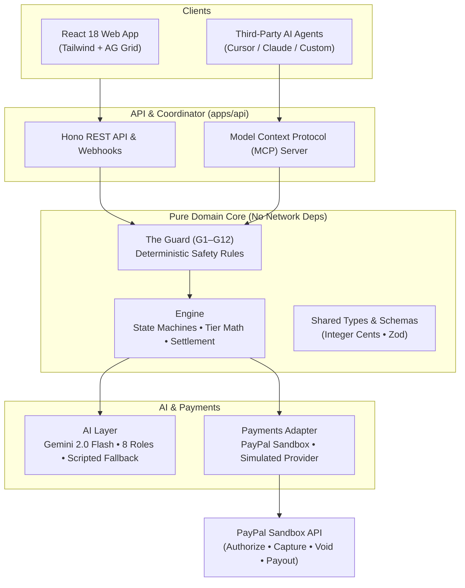

# Quorum Architecture & Technical Specification

Quorum is a multi-agent collective bargaining protocol built for **"Build What's Next with PayPal and AI"** (PayPal AI Hackathon 2026).

## Package Directory

| Package | Purpose |
|---|---|
| `packages/shared` | Types, Zod schemas, status enums, constants, and integer-cents money arithmetic. |
| `packages/engine` | Pure business logic: Coalition & Member finite-state machines, volume tier pricing, quorum math, settlement planning, waiting list promotion, demo clock, and ledger reconciliation. |
| `packages/guard` | Pure deterministic safety rules (G1–G12). Validates all AI proposals and money operations. Zero AI, zero network. |
| `packages/payments` | Payment Provider Interface with `PayPalSandboxProvider` (REST API with OAuth token caching & idempotency) and `SimulatedProvider` (with failure injection). |
| `packages/ai` | Gemini 2.0 Flash provider wrapper, 8 specialized agent roles, adversarial seller simulation, low-temperature schema validation, and scripted fallback. |
| `apps/api` | Fast backend server serving REST endpoints, PayPal webhooks, judge scenario runner, and native Model Context Protocol (MCP) server. |
| `apps/web` | React 18 + Tailwind CSS + AG Grid frontend featuring autonomous price curve, quorum meter, member roster, auditable ledger, and judge console. |

## Money Safety Invariants

1. **Integer Cents Only:** No floating-point rounding errors. All internal monetary calculations use integer cents (USD).
2. **Authorize-Then-Capture:** Money is placed on authorization hold when human approves. No funds move until quorum locks.
3. **Partial Capture for Windfalls:** If volume increases after approval and price drops, buyers are charged the lower final price via partial capture. The remainder is automatically released.
4. **Autonomous Self-Healing:** The waiting list heals capture-time card failures without human intervention.
5. **Exact Reconciliation:** Every reserve, capture, void, refund, and staged payout must reconcile to exactly $0.00 difference.
